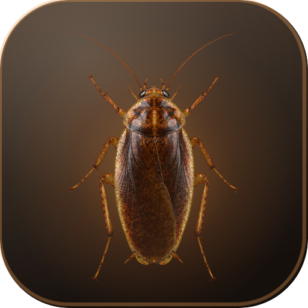
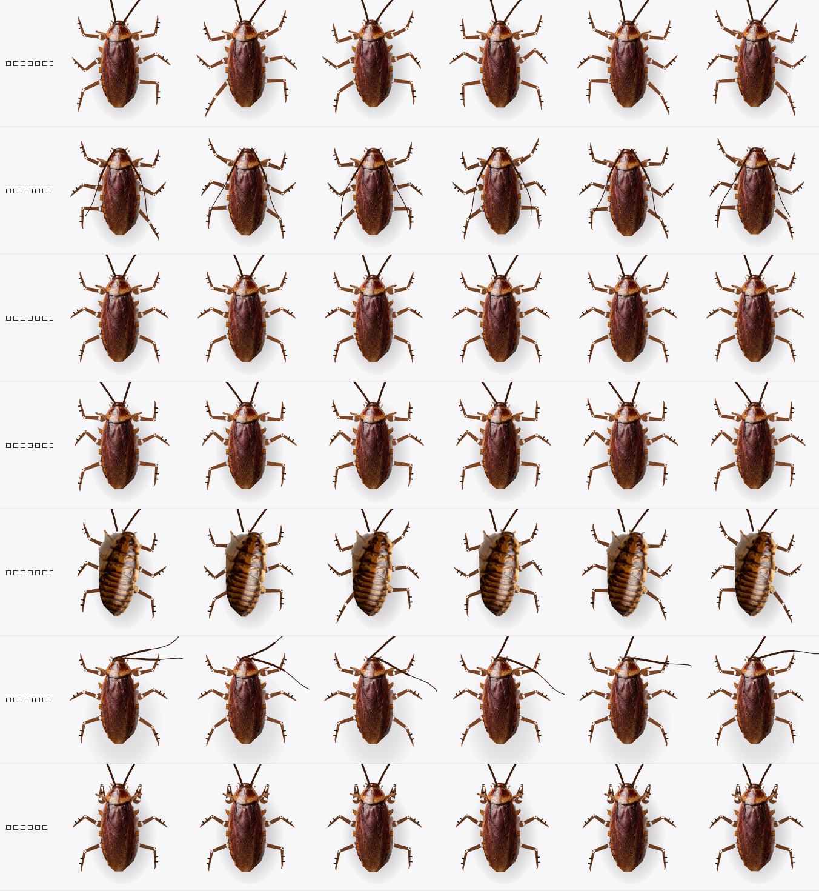
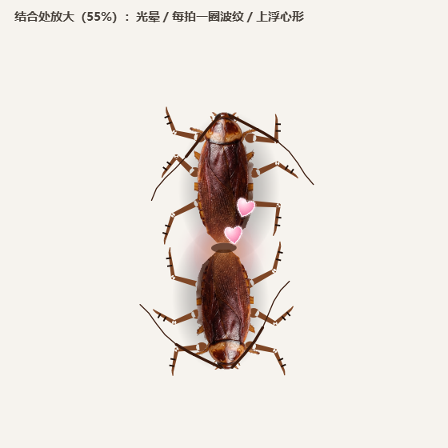
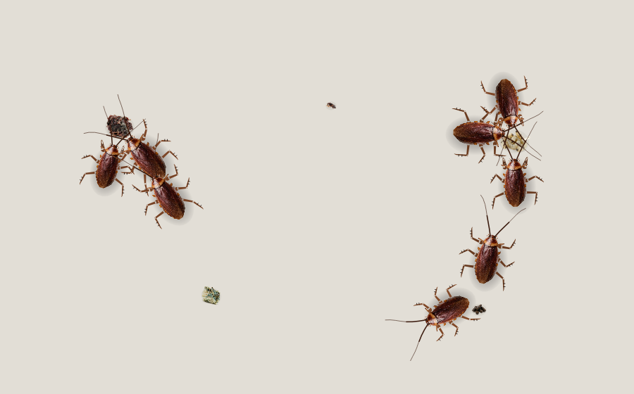
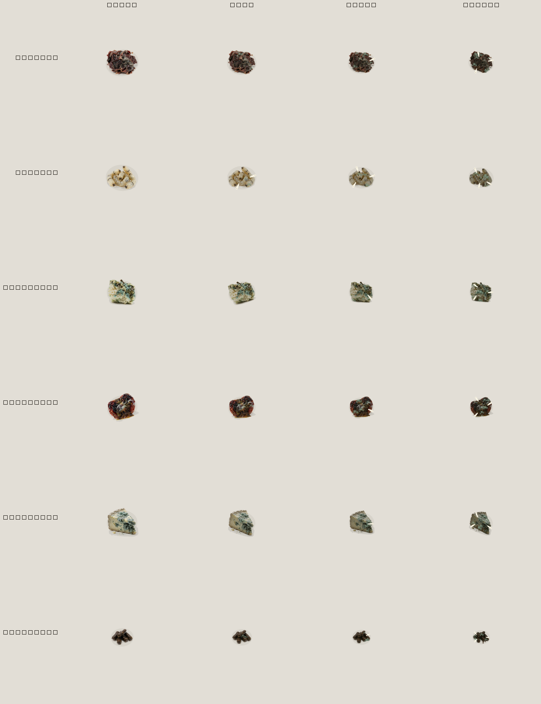
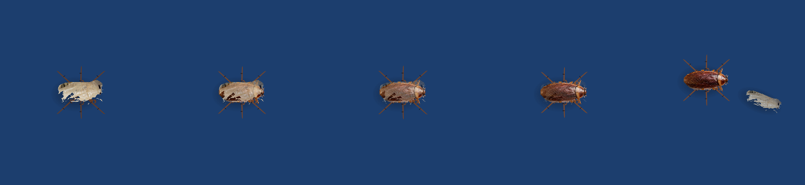
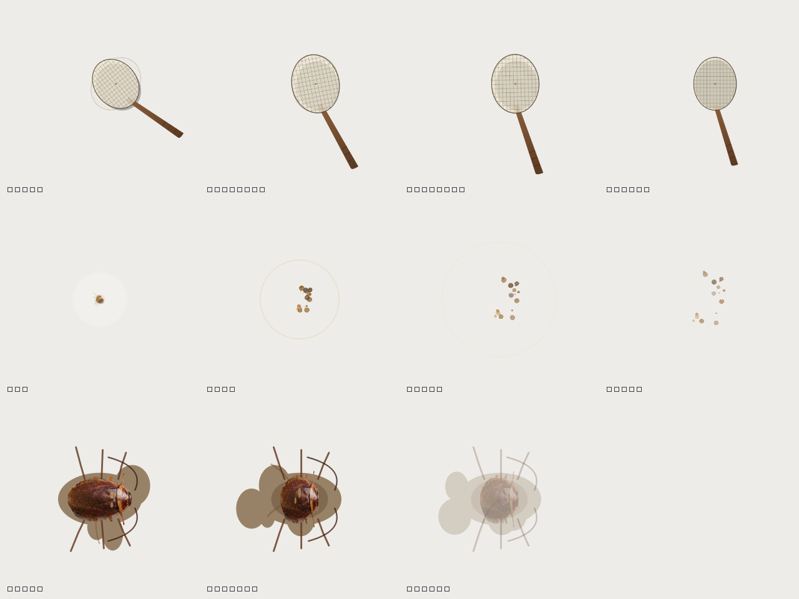

<div align="center">



# 🪳 roachHub

**桌面高拟真蟑螂生态模拟器**

一只运行在桌面透明覆盖层上的蟑螂 —— 真实的外观、程序化的六足步态、
完整的觅食 / 交配 / 产卵 / 蜕皮生命周期，以及一把能拍死它的苍蝇拍。

[](https://github.com/codeInbpm/roachHub/releases/latest)


[](#)



*程序化骨架驱动 · 7 种行为状态逐帧 · 每一只都是实时算出来的，不是贴图*

</div>

---

## ✨ 一句话看懂它

> 把它投放到桌面 → 它会**爬、避让、找吃的、交配、拖卵鞘、蜕皮长大**；
> 你可以**拎起来看它挣扎**、**拍死它**、**一键刷满全屏**——
> 而它从不挡你的点击、不抢你的任务栏、不用装 Python。

<table>
<tr>
<td width="50%" valign="top">

**🧬 完整生态循环**
处女雌虫不产卵、交配受精才有额度、
卵鞘拖在尾后孵化、多龄期蜕皮、
软壳期不受惊、终龄羽化长翅。

</td>
<td width="50%" valign="top">

**🦴 程序化六足动画**
交替三足步态 + 两段式 IK + 鞭状触须行波，
游走 / 惊慌 / 梳理 / 交配之间是平滑过渡
而不是"贴图换帧"。

</td>
</tr>
<tr>
<td width="50%" valign="top">

**🍽 真实进食与腐败**
23 种照片质感的食物各自有营养值与
保质期，放久了发黑长霉爬蛆，
被啃过的坏得更快。

</td>
<td width="50%" valign="top">

**🔨 可以拍死它**
拿起蟑螂拍（`Ctrl+Alt+S`），
命中即爆浆留渍、全场炸逃、屏幕微震。
拍空只留一缕灰尘气声。

</td>
</tr>
<tr>
<td width="50%" valign="top">

**🖐 拎起来会挣扎**
按住任意蟑螂：临界阻尼弹簧跟随、
六足乱蹬、超 6 秒触发装死（真实蟑螂的
假死反应 Thanatosis）。

</td>
<td width="50%" valign="top">

**🛡 不打扰你的桌面**
只在蟑螂身上接收鼠标，任务栏与
控制台永远让位，200 只同屏
依然不卡（p95 帧间隔 34ms）。

</td>
</tr>
</table>

---

## 📥 下载即用（不用装 Python）

前往 **[Releases](https://github.com/codeInbpm/roachHub/releases/latest)** 下载对应平台的包：

| 平台 | 文件 | 用法 |
| --- | --- | --- |
| 🪟 Windows 10/11 x64 | `roachHub-windows-x64.zip` | 解压后双击 `roachHub.exe`（整个文件夹一起拷走） |
| 🍎 macOS Apple Silicon | `roachHub-macos-arm64.dmg` | 打开后把 `roachHub` 拖进「应用程序」 |
| 🍎 macOS Intel | `roachHub-macos-x86_64.dmg` | 同上 |

<details>
<summary>⚠️ 首次打开系统会拦一次（未签名），怎么办？</summary>

两个包都没有做 Apple 公证 / Windows 代码签名：

- **macOS**：右键 App →「打开」（或终端执行 `xattr -cr /Applications/roachHub.app`）
- **Windows**：弹出蓝色提示时点「更多信息 → 仍要运行」

</details>

---

## 🌟 核心特性

### 🧬 繁衍系统：从求偶到受精，每一步都有依据

**只有雌虫能产卵，而且必须先受精**——处女雌虫能量再满也生不出来。
交配一次可支撑多枚卵鞘（雌虫储精，默认 2 枚），额度用完才需要重新交配。
两种模式只差交配仪式的严格程度：

| | 🚀 简化交配（默认） | 🎬 写实有性 |
| --- | --- | --- |
| 判定 | 靠近约 1.15 倍体长即受孕（1.5s） | **真实尾对尾交尾**（2.2s） |
| 寻偶 | 雌虫在感应距离内找雄虫 | 雌虫扫描 + 雄虫循性信息素跨屏找来 |
| 动作 | 蹭一下就成 | 雄性沿体轴挺动（1.6→4.8Hz 由慢到快）、扭摆、腹部收缩、末段退开抽离 |
| 特效 | — | 暖色光晕呼吸、扩散波纹、上浮心形、触角颤动 |

<div align="center">

<br><em>结合处特效：光晕 / 每拍一圈波纹 / 上浮心形（世界坐标，任何朝向都朝屏幕上方飘）</em>
</div>

> 交尾中任一方受惊（光标贴近、被拍、被拎走），交配**立即中断**，各自逃窜重新找机会。
> 详细模型见 [`docs/reproduction.md`](docs/reproduction.md)。

### 🍽 进食与腐败：桌面会真的"脏"起来

- **23 种**真实照片质感的食物（腐肉块、蛆虫团、死毛毛虫、老鼠屎、霉面包、烂番茄、霉奶酪、死苍蝇……），各自有营养值（18~78）、体积与 1~3 个进食位点；
- 每 0.4 秒咬一口，前足把食物收到口器前，被啃食时**肉眼可见地缩小**；位点占满后后来的虫在外圈排队等待；
- **会腐败**：放久了发黑、长蓝绿菌斑、边缘爬出白蛆、底部渗液，营养最多流失 45%，到期化掉消失——**被啃过的坏得更快**（最多 1.9 倍）。

<div align="center">
<table><tr>
<td><br><em>进食位形：多只虫围绕食物的停靠环</em></td>
<td><br><em>23 种食物 × 4 档腐败：发黑 → 菌斑 → 蛆虫 → 化掉</em></td>
</tr></table>
</div>

> 完整食物清单与营养账见 [`docs/food.md`](docs/food.md)。

### 🐣 多阶段成长：多龄期蜕皮

<div align="center">

<br><em>刚蜕完的嫩壳是乳白半透明，约 2 秒后颜色化开变深，桌上留下蜕掉的空壳</em>
</div>

- **若虫期**：无翅、多节背板，多龄期蜕皮逐步放大；
- **软壳期不受惊**：蜕皮中的个体只能感知不能行动（真实蟑螂此时连爬都费劲），鼠标贴上去它不会跑；
- **成虫期**：终龄羽化长出翅鞘，具备繁衍能力。

### 🖐 互动层：它知道你在碰它

- **触须嗅探**：感知半径内两根触须分开 ±0.22 rad 精确指向光标，静止时会有 0.35~0.6s 的"探一探"；
- **鼠标分级感知**：远距触角警戒 → 中距避让 → 近距"收触须 0.12s → 僵直 → 爆发冲刺"；
- **抓取与挣扎**：临界阻尼弹簧跟随（有惯性晃荡）、六足乱蹬、触须狂扫、影子拉远；松手瞬间惊慌逃窜；
- **装死（Thanatosis）**：拎住超 6 秒全身瘫软装死，松手后先瘫 0.9 秒再逃——真实蟑螂被抓后的反应；
- **悬停看状态**：停在任何虫上浮出小卡片（能量 / 健康 / 产卵余额），**平时不显示任何数字**；
- **痕迹**：极淡的脚印（含爪垫点）与腹部油渍，约 6 秒淡出，托盘一键擦除；
- **音效**：运行时合成 4 种窸窣短音（落地 / 咬食 / 受惊 / 闷响）+ 抓取音效「你干嘛~哎呦」+ 拍死惨叫，独立开关与音量。

> 实现细节与验收数据见 [`docs/interactions.md`](docs/interactions.md)。

### 🔨 蟑螂拍：可以拍死它

托盘菜单或 `Ctrl+Alt+S` 拿起拍子，网格拍面半透明地跟着光标走——
左键 70ms 下压，命中半径内当场压扁爆浆，留一摊污渍和一具抽搐的尸体；
附近 240px 全部炸开逃窜、屏幕抖 3px。**右键 / 再按热键 / 12 秒不挥拍**即放下，桌面马上恢复"能点"。
一次最多拍死 4 只，拍空只给灰尘环和气声。

<div align="center">

<br><em>拍子形态 / 挥拍轨迹 / 爆浆颗粒 / 尸体渐隐</em>
</div>

> 输入闸门、鼠标路由与命中判定的完整设计见 [`docs/swatter.md`](docs/swatter.md)。

---

## ⌨️ 全局热键（应用无焦点也生效）

| 热键 | 作用 |
|:---:| --- |
| `Ctrl+Alt+R` | 显示 / 隐藏控制台 |
| `Ctrl+Alt+H` | 隐藏 / 显示桌面蟑螂 |
| `Ctrl+Alt+B` | ⚡ 虫巢爆发（一键刷满到上限并全场受惊四散） |
| `Ctrl+Alt+S` | 拿起 / 放下蟑螂拍 |

四个都能在控制台里改（点进输入框直接按组合键），**留空 = 禁用**；被其他程序占用时会标注「未生效」。
托盘单击 = 召唤控制台（微信习惯）；重复启动不会再叠一个实例，而是把已运行的那个叫到前台。

---

## 📊 性能：多少只都不卡死

| 场景（2560×1440 实测） | 数值 |
| --- | --- |
| 50 只同屏 | 56 FPS |
| 100 只同屏 | 32.6 FPS |
| **200 只同屏** | **30.5 FPS**（p95 帧间隔 34ms，无 >250ms 卡顿） |

保障机制：动态 LOD 先降肢体精度 → 画质见底才降帧率（绝不硬撑目标帧率）；只在蟑螂身上接收鼠标
（`WM_NCHITTEST`，满屏足迹一律 `HTTRANSPARENT`）；任务栏与控制台矩形永远让位。
细节见 [`docs/performance.md`](docs/performance.md)。

---

## 🖥️ 控制台

启动即弹出，`Ctrl+Alt+R` 随时召唤/收起。顶部品牌栏 + 6 个页签 + 状态栏：

| 页签 | 里面有什么 |
| --- | --- |
| 🪳 控制台 | 群落进度条 / ⚡虫巢爆发 / 批量投放蟑螂（混合·成虫·若虫）/ 批量投放食物（按营养分三档 + 随机加权）/ 驱散 / 隐藏 |
| 🖱️ 互动与氛围 | 抓取、桌面痕迹、三种音效的开关与音量，音效可试听 |
| 🔨 苍蝇拍 | 启用、判定半径、显示大小、闲置收拍、爆浆量、震屏、已拍死统计 |
| ⌨️ 快捷键 | 四个热键录入 + 实时生效状态、启动行为、界面语言 |
| 🖥️ 窗口 | 目标帧率 / 最低帧率下限（"不卡死"保险丝） |
| 🌱 繁衍与生命周期 | 繁殖模式、感应距离、雌性比例、能量阈值、交配耗时、卵鞘数量与存放方式等 12 项 |

<details>
<summary>📦 托盘右键菜单全览</summary>

| 菜单项 | 作用 |
| --- | --- |
| 🖥️ 打开控制台 | 召唤控制台（`Ctrl+Alt+R`） |
| 🔨 拿起蟑螂拍 | 持拍期间左键挥拍、右键放下 |
| ⚡ 虫巢爆发 | 补满到上限并全场受惊四散 |
| ➕ 投放蟑螂 ▸ | 1 / 10 / 50 / 100 只 |
| 🪳 投放食物 ▸ | 招牌 7 种 + 随机混合；完整 23 种在控制台 |
| 👁 隐藏桌面蟑螂 | 隐藏/显示覆盖层 |
| 🧹 擦掉桌面痕迹 | 立刻清空足迹与油渍 |
| 🔇 静音 | 一键压掉全部音效，状态写回配置 |
| 🧹 驱散所有蟑螂与物体 | 清空生态 |

</details>

---

## 🚀 从源码运行

```bash
# 双击最干净的方式：没有控制台窗口
python roachHub.pyw

# 控制台会被自动隐藏；要盯着日志跑：
python main.py --keep-console    # --debug 额外输出 DEBUG
```

打包为独立程序（目标机器不需要 Python）：

```bash
powershell -ExecutionPolicy Bypass -File packaging\build_windows.ps1   # → dist\windows\roachHub\
./packaging/build_macos.sh                                            # → dist/macos/roachHub.dmg
```

平台差异、资源定位与 macOS 适配细节见 [`docs/packaging.md`](docs/packaging.md)。

---

## 🧰 开发与测试

<details>
<summary><strong>全部离线验证工具（点击展开 · <code>tools/</code>）</strong></summary>

| 命令 | 作用 |
| --- | --- |
| `python tools/build_body_sprites.py` | 从照片重新拆出「纯躯干」贴图（切掉烘焙的腿与触须） |
| `python tools/preview_animation.py` | 导出逐帧接触表 + 可播放的 `preview_animation.html`（7 种状态） |
| `python tools/gait_diag.py` | 足端轨迹诊断图，验证支撑相/摆动相相位 |
| `python tools/interaction_test.py` | 互动层脚本化验收（108 项） |
| `python tools/swatter_test.py` | 苍蝇拍验收（60 项），输出 `swatter_sheet.png` |
| `python tools/reproduction_test.py` | 繁衍验收（45 项：受精额度 / 打断不死锁 / 交配动作与特效 / 开销预算） |
| `python tools/mating_preview.py` | 出交配 8 帧 / 结合处放大 / 4 朝向心形验证 / 浅深底对照 |
| `python tools/food_test.py` | 食物与状态卡片验收（64 项） |
| `python tools/food_preview.py` | 出腐败对照 / 桌面实景 / 进食位形 / 停靠环 |
| `python tools/prepare_food_sprites.py` | 把 AI 素材裁成 23 张贴图 + 69 张腐蚀染色 |
| `python tools/starve_probe.py` | 饿死诊断：真实主循环跑定时长，逐窗供需账 |
| `python tools/repro_probe.py` | 繁衍速率探针：跑种群曲线，输出鞘/分钟 |
| `python tools/interaction_preview.py` | 互动层视觉回归图 + 痕迹层开销实测 |
| `python tools/prepare_voice.py` / `voice_sections.py` / `voice_preview.py` | 抓取音效裁切与试听链 |
| `python tools/prepare_yamero_voice.py` / `prepare_squash_voice.py` / `squash_preview.py` | 拍死音效派生与试听 |
| `python tools/smoke_test.py` | 离屏跑 180 tick + 渲染性能基准 |
| `python tools/perf_probe.py` | 逐阶段帧预算拆解 |
| `python tools/soak_test.py` | **真机**浸泡：真实帧间隔、卡顿次数 |
| `python tools/make_icon.py` | 一条命令重生成整套图标（多尺寸 ICO + 抠图） |
| `python tools/hole_check.py` | **真机**诊断"虫子跑到某块区域就消失" |
| `python tools/sim_profile.py` / `render_breakdown.py` | cProfile 热点 / 单只渲染拆解 |

无显示环境请加 `QT_QPA_PLATFORM=offscreen`（Windows 用 `.venv/Scripts/python.exe`）。

</details>

---

## 📚 文档索引

| 文档 | 内容 |
| --- | --- |
| [`docs/animation-system.md`](docs/animation-system.md) | 动画实现与参数表 |
| [`docs/reproduction.md`](docs/reproduction.md) | 繁衍模型（性别 / 求偶 / 受精额度 / 实测速率） |
| [`docs/food.md`](docs/food.md) | 食物体系（23 种 / 贴图内存账 / 腐败规则 / 代谢与死因） |
| [`docs/interactions.md`](docs/interactions.md) | 互动层实现与验收 |
| [`docs/fun-features.md`](docs/fun-features.md) | 趣味性方案（已全部落地） |
| [`docs/console.md`](docs/console.md) | 控制台 / 热键 / 批量投放 |
| [`docs/swatter.md`](docs/swatter.md) | 蟑螂拍设计 |
| [`docs/branding.md`](docs/branding.md) | 启动方式 / 图标 / 单窗口 |
| [`docs/packaging.md`](docs/packaging.md) | 打包与跨平台适配 |
| [`docs/performance.md`](docs/performance.md) | 性能实测与"多少只都不卡死"的实现 |
